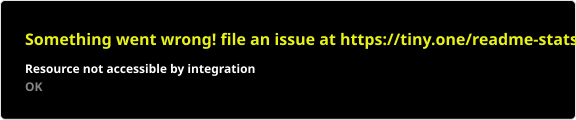

# Malo periculosam libertatem quam quietum servitium

<p align="center">
  <a href="https://wakatime.com/@3a9424b2-a7e9-45b1-b004-c0da731ae6d1">
    
  </a>
  <a href="https://github.com/MattRiel">
    
  </a>
  
</p>

---

## 🛠️ Tech Stack

<p align="center">
  
  &nbsp;
  
  &nbsp;
  
  &nbsp;
  
  &nbsp;
  
  &nbsp;
  
  &nbsp;
  
  &nbsp;
  
  &nbsp;
  
  &nbsp;
  
  &nbsp;
  
  &nbsp;
  
</p>

---

## 📊 GitHub Statistics

<p align="center">
  <a href="https://github.com/MattRiel">
    
  </a>
</p>

<p align="center">
  
  
</p>

<p align="center">
  
  
</p>

---

## 📈 Contribution Activity

<p align="center">
  
</p>

<p align="center">
  <picture>
    <source media="(prefers-color-scheme: dark)" srcset="https://raw.githubusercontent.com/MattRiel/MattRiel/pacman-output/pacman-contribution-graph-dark.svg">
    <source media="(prefers-color-scheme: light)" srcset="https://raw.githubusercontent.com/MattRiel/MattRiel/pacman-output/pacman-contribution-graph.svg">
    
  </picture>
</p>

---

## ⏱️ Weekly Coding Activity

<!--START_SECTION:waka-->

```text
From: 18 November 2026 - To: 25 November 2026

Total Time: 33 hrs 36 mins

PHP          20 hrs 38 mins  ███████████████▒░░░░░░░░░  61.43 %
Markdown      3 hrs 28 mins  ██▓░░░░░░░░░░░░░░░░░░░░░  10.32 %
TypeScript    2 hrs 52 mins  ██░░░░░░░░░░░░░░░░░░░░░░   8.54 %
JavaScript    1 hr 41 mins   █▒░░░░░░░░░░░░░░░░░░░░░░   5.03 %
Docker        1 hr 28 mins   █░░░░░░░░░░░░░░░░░░░░░░░   4.40 %
```

<!--END_SECTION:waka-->

---

<p align="center">
  <i>Malo periculosam libertatem quam quietum servitium.</i>
</p>
